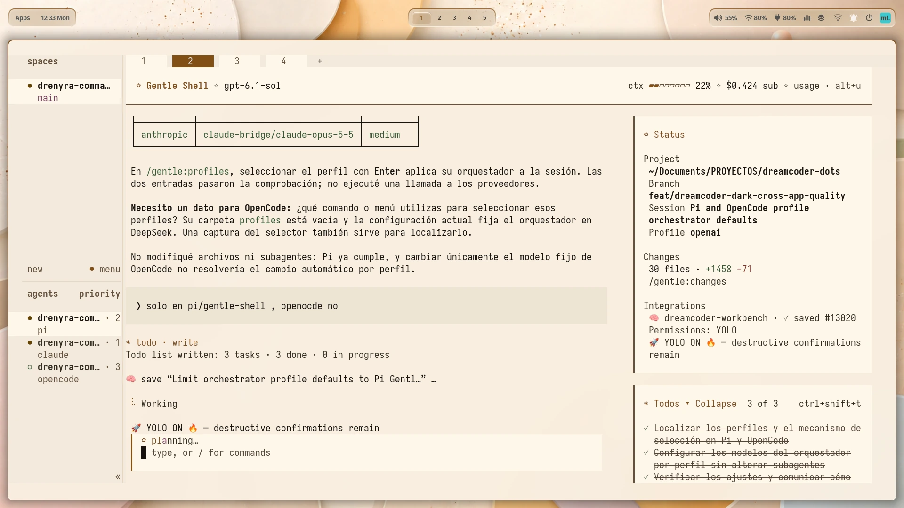

# Dreamcoder Workbench

[](LICENSE)
[](pyproject.toml)
[](https://pypi.org/project/dreamcoder-theme/)

Dreamcoder Workbench is a terminal-native development environment and personal
dotfiles overlay. It brings together a token-based theme engine, tool
configurations, machine profiles and health checks for a consistent workspace.
It builds on, rather than replaces, [Gentleman.Dots](https://github.com/Gentleman-Programming/Gentleman.Dots)
and [ML4W](https://ml4w.com/).



## Contents

- [What is included](#what-is-included)
- [Quick start](#quick-start)
- [Platform boundaries](#platform-boundaries)
- [Documentation](#documentation)
- [Support and contributions](#support-and-contributions)
- [Acknowledgements and license](#acknowledgements-and-license)

## What is included

- A Python theme engine that generates component themes from shared tokens,
  with contrast validation and user-facing dark/light modes.
- Configurations for terminal and development tools, including Neovim, Kitty,
  Ghostty, Tmux, Zellij and shell environments.
- ML4W integration and machine-specific profiles for desktop and mobile use.
- Theme integrations for AI tools, including Pi, OpenCode and Codex.
- An installer, synchronization tools and commands for inspecting workspace health.

Dreamcoder Workbench owns the overlay, profiles, theme engine and generated
variants in this repository. Gentleman.Dots supplies a shell, editor and terminal
base; ML4W supplies the Hyprland desktop base. See the
[source manifest](docs/sources.md) for the ownership boundary and upstream pins.

## Quick start

Get the configuration and guides without applying changes to your home directory:

```bash
git clone https://github.com/Dreamcoder08/Dreamcoder-Workbench.git
cd Dreamcoder-Workbench
```

1. Review the [installation guide](INSTALL.md) and back up your existing
   configuration before applying an overlay.
2. Follow its setup path for Gentleman.Dots, ML4W and Dreamcoder Workbench on
   the intended desktop, then use its verification and troubleshooting steps.
3. Choose a [configuration guide](docs/README.md) for the tools you use.

The Python theme package requires Python 3.11 or newer and Jinja2. The
`scripts/dreamcoder` entry point exposes the source tree through `PYTHONPATH`,
but its Python dependencies must still be available. See the installation guide
for setup rather than assuming that running the script installs them.

## Platform boundaries

The full desktop journey is intended for Arch Linux or a derivative with ML4W.
Other platforms have component-specific guides; they are not a guarantee that
the complete desktop or every integration works there. Check the relevant
[platform guide](docs/README.md) and the requirements of each tool before applying
configuration.

## Documentation

The [documentation hub](docs/README.md) routes you to installation,
configuration, theme development and technical references. Useful starting
points:

- [Installation](INSTALL.md) — full desktop setup and verification.
- [Theme system](docs/configuration/theme-system.md) — tokens, generated themes
  and synchronization.
- [ML4W integration](docs/configuration/ml4w.md) — profiles and keybindings.
- [Source manifest](docs/sources.md) — upstream inputs and repository ownership.
- [Contributing](CONTRIBUTING.md) — development setup and contribution guidance.

## Support and contributions

For a bug report or feature request, open an issue in the
[GitHub repository](https://github.com/Dreamcoder08/Dreamcoder-Workbench/issues).
Include your platform, the affected component, relevant output with personal
information removed, and steps to reproduce the problem. Contributions are
welcome; see [CONTRIBUTING.md](CONTRIBUTING.md). The
[changelog](CHANGELOG.md) records project changes.

## Acknowledgements and license

Thanks to the [Gentleman.Dots](https://github.com/Gentleman-Programming/Gentleman.Dots)
and [ML4W](https://ml4w.com/) projects for the upstream environments this
workbench builds upon. Their projects remain independently maintained.

Dreamcoder Workbench is distributed under the [MIT license](LICENSE).
