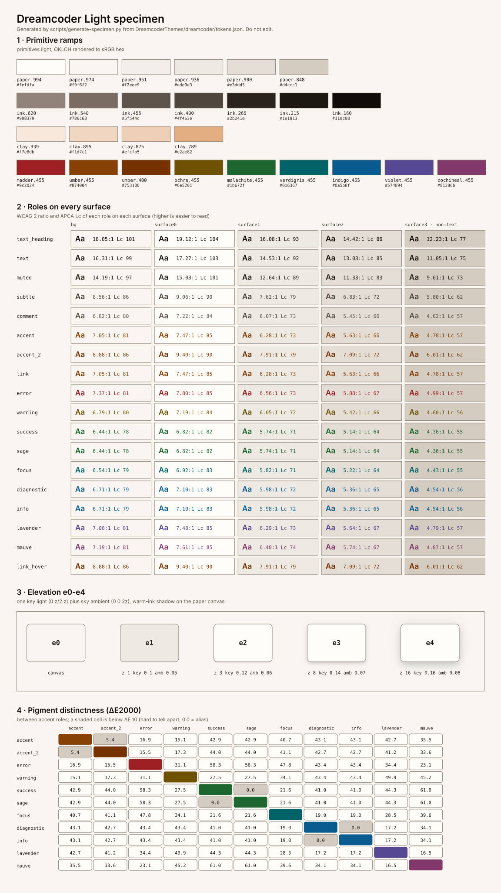

# Dreamcoder Design System

← Back to [docs/README.md](README.md)

Dreamcoder Workbench is a personal developer-experience design system for Arch Linux workstations. It is a token-governed visual layer for terminals, editors, shell tools, desktop chrome, notes, browser chrome and AI coding CLIs. This page is the single source for how that system is built and checked; operational how-tos live in the pages it links.

**Short version:** every colour comes from `DreamcoderThemes/dreamcoder/tokens.json`. Dreamcoder Light is modelled as one physical material (paper, ink, clay and mineral pigments) under one overhead light, and each rule below has a measurable check. Run `make theme-check` to verify all of it.

## Contents

| Section | Answers |
| --- | --- |
| [Product definition](#product-definition) | What the system optimizes for |
| [Token contract](#token-contract) | Where values live, the three tiers, the single-source rule |
| [Light material model](#light-material-model) | Paper, ink, clay, pigments and the laws they obey |
| [Elevation](#elevation) | One light, key plus ambient shadows |
| [Rhythm](#rhythm) | 4 px grid, type contract, motion |
| [Semantic chrome](#semantic-chrome) | Badges, tiles, borders and the wash rule |
| [Wallpaper contract](#wallpaper-contract) | Measurable limits a wallpaper must meet |
| [Tooling](#tooling) | Commands that verify and report |
| [Component model](#component-model) | Cross-application primitives |
| [Accessibility policy](#accessibility-policy) | WCAG and APCA floors |
| [Governance](#governance) | How changes land |

## Product definition

Dreamcoder Workbench optimizes long coding sessions around three principles:

1. **Readability before decoration**: text, selections, borders and diagnostics must survive real terminal and editor use.
2. **Health-aware identity**: Dreamcoder Dark reserves pure black for its canvas through `surface_policy`, and functional and scrollable surfaces use near-black tones. Light avoids pure black and pure white.
3. **Operational resilience**: ML4W and Gentleman updates are expected; the system must be repairable, auditable and regenerable.

The user-facing modes are `dark` and `light`. The system is a developer-OS design system, not a web component library; its rigor is inspired by Material, Carbon, Spectrum and Fluent.

## Token contract

`DreamcoderThemes/dreamcoder/tokens.json` is the canonical token source, validated by `tokens.schema.json`. Generated files never invent colour decisions: renderers translate tokens into each target's syntax.

### Token tiers

| Tier | Key in `tokens.json` | Holds | Example |
| --- | --- | --- | --- |
| 1 Primitives | `primitives.light` | Named OKLCH colours | `"paper.974": "oklch(…)"` |
| 2 Semantic | `bindings.light` → `modes.<mode>` | A role bound to a primitive; `modes.*` stays flat hex so every consumer reads it unchanged | `bg` → `paper.974` |
| 3 Components | `components` | Non-colour geometry and behaviour, plus the colour name of a component | `elevation`, `radius`, `border`, `spacing`, `motion`, `typography`, `wallpaper` |

- Primitives are authored in OKLCH so lightness, chroma and hue are controlled independently; `src/dreamcoder_theme/color_space.py` converts to sRGB hex and holds the CIEDE2000 (ΔE2000) implementation.
- `src/dreamcoder_theme/token_tiers.py` resolves bindings; `elevation.py` and `rhythm.py` resolve the component tier. `scripts/verify-theme-health.py` reports `TIER_DRIFT` (a `modes.light` hex that differs from its binding) and `TIER_UNBOUND` (a binding naming a missing primitive).
- Tiers 1 and 2 are populated for Light. Dark keeps flat hex; its dark bindings are not authored.

### Single-source rule

- **Versioned token schema**: `DreamcoderThemes/dreamcoder/tokens.schema.json` defines the public token shape.
- **Mode parity**: `light` and `dark` expose equivalent semantic roles.
- **Semantic separation**: `accent`, `accent_2`, `diagnostic`, `warning`, `error`, `comment`, `subtle`, `focus`, `border_ui` and `border_hi` remain distinct.
- **No hand-copied Light hex**: `sync_light_files` generates the Light-only colour files listed in `LIGHT_FILES` (`src/dreamcoder_theme/renderers_light_files.py`: Alacritty, WezTerm, Nushell, three Tmux files, Yazi) and splices the Zellij Light theme block in place. `tests/test_light_color_files.py` fails when any other tracked Light colour file uses a hex that is not a current Light token.
- **No silent drift**: mode variants are checked in; active-mode mirrors are generated by sync and gitignored (see [Generated active mirrors](configuration/theme-system.md#generated-active-mirrors)).
- **Derived values**: ANSI-16 is derived from semantic roles in `palette.py`; tokens carry no ANSI copy.

## Light material model

Light is one material: aged paper, written on with iron-gall ink, washed with mineral pigments. The laws below are pinned by `tests/test_light_material.py`, so an edit cannot drift out of the model unnoticed.

| Family | Primitives | Law | Why |
| --- | --- | --- | --- |
| Paper | `paper.*` (surfaces) | Hue stays within 70–84° and never swings back toward yellow as lightness falls; chroma rises monotonically as lightness falls | Lignin in cellulose yellows and reddens with age, so deeper paper is warmer and more chromatic |
| Ink | `ink.*` (text, comment, borders) | One hue axis (spread ≤ 2°); adjacent steps at least 0.05 OKLCH lightness apart | Iron-gall and sepia inks are brown-black, never neutral grey; distinct steps keep `text`, `muted`, `comment` and borders separable |
| Clay | `clay.*` (selection, prompt surfaces) | One hue axis; chroma falls as lightness rises | A clay tone is an umber wash over paper; a thinner wash is lighter and less chromatic (Kubelka–Munk thin layer) |
| Pigments | `madder`, `umber`, `ochre`, `malachite`, `verdigris`, `indigo`, `violet`, `cochineal` | All at one density (lightness within 0.01 of ≈ 0.455); every pair at least ΔE2000 12 apart | Isoluminant pigments cannot be told apart by brightness, so hue alone carries meaning; ΔE2000 ≥ 12 keeps neighbours distinct, well above the ≈ 2 just-noticeable difference |

Pigment roles:

| Role | Pigment |
| --- | --- |
| `error` | madder |
| `accent`, `link` | umber (iron-oxide earth); hover (`accent_2`) is a deeper umber within 6° hue |
| `warning` | ochre |
| `success` | malachite |
| `focus` | verdigris |
| `info`, `diagnostic` | indigo (one shared primitive) |
| `lavender` | violet |
| `mauve` | cochineal |

Readability is part of the model: every pigment role, `accent_2`, `subtle` and `comment` reaches WCAG 4.5:1 on each text surface (`bg`, `bg_soft`, `surface0`–`surface2`) and APCA Lc ≥ 75 on `bg`; `accent_2` stays at least ΔE2000 12 from `error` so a hovered link never reads as an error. Measured when the model landed: minimum pigment-pair ΔE2000 15.1, minimum WCAG 5.14 on the text surfaces.

## Elevation

Light uses one overhead light, slightly in front of the screen with no lateral offset, so every shadow falls straight down. Each level is a key term plus an ambient (sky) term, tinted with warm ink (`ink.215`), never black: light bouncing off warm paper keeps the umbra warm.

| Level | z (px) | Key shadow | Ambient shadow | Used for |
| --- | --- | --- | --- | --- |
| e0 | 0 | none | none | canvas (`bg`) |
| e1 | 1 | `0 0.5px 1px`, α 0.10 | `0 0 2px`, α 0.05 | modules and `surface1` |
| e2 | 3 | `0 1.5px 3px`, α 0.12 | `0 0 6px`, α 0.06 | cards (`surface0`) |
| e3 | 8 | `0 4px 8px`, α 0.14 | `0 0 16px`, α 0.07 | popovers, menus, rofi |
| e4 | 16 | `0 8px 16px`, α 0.16 | `0 0 32px`, α 0.08 | modals, notifications |

Geometry: radius `r1` 4 px, `r2` 8 px, `r3` 12 px (windows use `r3`); hairline border 1 px in `ink.620`. Depth must grow with each level and the resolver rejects a non-increasing scale (`tests/test_light_elevation.py`).

Wired in the renderers today: Hyprland shadow and scrim (warm ink instead of black), Waybar modules (`r2` + e1), rofi radii (`r3`/`r2`) and the OpenCode Light shadow.

## Rhythm

| Aspect | Contract |
| --- | --- |
| Spacing | 4 px base grid: `s1` 4, `s2` 8, `s3` 12, `s4` 16, `s6` 24, `s8` 32. The resolver rejects an off-grid step; every Light padding, margin, gap and radius a renderer emits is checked against the grid |
| Type | Light shares Dark's `typography` contract: body weight 400, emphasis 500, heading 600, letter-spacing 0 (uppercase 0.04 em). Mono and UI families are recorded once as `JetBrainsMono Nerd Font` and are not emitted, because ML4W owns fonts |
| Motion | Durations `quick` 120 ms, `base` 200 ms, `slow` 320 ms (monotone, ≈ 1.6× steps). Curves are critically damped approximations with no overshoot or bounce: enter `cubic-bezier(0.22, 1, 0.36, 1)`, exit `cubic-bezier(0.4, 0, 1, 1)`, move `cubic-bezier(0.33, 0, 0.2, 1)`; the resolver rejects an overshooting curve |

Wired in Light artifacts: Hyprland gaps 4/16 and `dc_enter`/`dc_exit`/`dc_move` animations, Waybar module padding, margin and weights, rofi entry, element and listview rhythm. Dark artifacts carry no rhythm tokens; Dark adoption is a follow-up. Checks: `tests/test_light_rhythm.py`.

## Semantic chrome

Colour in chrome means something, and it is applied the way a thin pigment layer behaves on paper.

- **Wash rule**: a coloured chip, badge or tile is its pigment at 12–16% over paper as the fill, and the same pigment as text or icon. Light chrome has no saturated solid fills (`tests/test_light_semantic_chrome.py` caps the wash alpha at 0.16).
- **Count badges** (for example Waybar updates): a neutral clay chip (`selection` fill, `accent` text). Only real critical states use the madder wash.
- **Window borders**: the Hyprland Light active border is solid `accent`, with no gradient; inactive uses `inactive_border`.
- **Gentle Shell and Pi**: no dark fills inside Light; tool and delegation blocks use `surface1` or `surface0` with a pigment left rule and ink text.
- **Live override caveat**: the ML4W badge wash lives in `style-custom.css`, and GTK CSS cannot tell modes apart, so Dark live badges become washes too.
- **Open items**: the ML4W Lua window gradient (`conf/windows/default.lua`) and the teal `ml.` launcher tile (an ML4W SVG) are not yet overridden; the Gentle Shell "Delegating" card colour is owned upstream.

## Wallpaper contract

`components.wallpaper.<mode>` in `tokens.json` defines what a wallpaper must satisfy so the UI stays readable and the image belongs to the same material. Limits are measured in OKLab on a 480×270 downsample (`src/dreamcoder_theme/wallpaper_contract.py`), and the contract is the only definition of the numbers.

| Rule | Light | Dark | Why |
| --- | --- | --- | --- |
| Size | ≥ 3840×2160, 16:9 ±1% | same | Native 4K, never an upscaled blur |
| Mean lightness (OKLab L) | 0.86–0.97 | 0.08–0.22 | Sits in the paper band of the UI |
| Chroma | p95 ≤ 0.060, mean ≤ 0.035 | same | A saturated wallpaper overpowers the UI paper |
| Hue | chroma-weighted mean within ±25° of 70° when mean chroma ≥ 0.01 | same | Stays on the paper, clay and umber axis |
| Bar safe zone (top and bottom 6%) | lightness std ≤ 0.035, mean ≥ 0.88 | lightness std ≤ 0.035 | Quiet bands under Waybar |
| Bar readability | `module_rgba` over the darkest 1% of the top band keeps `text` ≥ 7:1 and `muted` ≥ 4.5:1 (WCAG) | same | Text stays legible on the worst pixels |
| Panel readability | `panel_rgba` over the darkest 1% of the image keeps `text` ≥ 7:1 | same | Same, for panels |

The contract checks images; it does not change the adaptive palette that Matugen derives from a wallpaper.

**Status:** the canonical set is `DreamcoderWallpapers/dreamcoder-light-*.png` and `dreamcoder-dark-*.png`. The earlier exports in that directory do not meet the contract (size, chroma, safe zone, and for the dark ones lightness and readability); they are replaced when the canonical set lands. For applying a wallpaper, see [Wallpaper and palette setup](../scripts/WALLPAPER_SETUP.md).

### Finishing pipeline

`scripts/finish-wallpaper.sh INPUT OUTPUT` turns a generated image into a contract-sized file. It needs ImageMagick (`magick`) and is byte-deterministic:

1. Centre-crop to 16:9.
2. Lanczos upscale to 3840×2160 in linear light: low-frequency art needs no source resolution.
3. Add native-resolution paper grain (additive, about 1.4 code values RMS; fixed seed).
4. Quantize to 8 bits with an ordered dither, so smooth paper gradients never band.

Then check the result with `scripts/check-wallpaper.py` (below).

## Tooling

| Command | What it does |
| --- | --- |
| `make theme-check` | Regenerates every output from `tokens.json` for dark and light (repo-only sync), fails on `git diff` against the index (stage intentional changes first), runs `verify-theme-health.py`, the theme tests, and the wallpaper contract on `DreamcoderWallpapers/dreamcoder-light-*.png` and `dreamcoder-dark-*.png` (skipped when none exist). Set `PYTHON` to choose the interpreter, for example `make theme-check PYTHON="uv run --quiet python"` |
| `make theme-diff [REF=origin/main]` / `scripts/theme-diff.py [REF]` | Perceptual regression report per semantic role between a git ref and the working tree: ΔE2000, WCAG and APCA deltas. A role at ΔE ≥ 2 is marked as visible; a contrast floor met in the base and missed in the head is reported as crossed (`--fail-on-floor` turns that into exit 1) |
| `make specimen` / `scripts/generate-specimen.py` | Writes the deterministic Light specimen board below |
| `scripts/check-wallpaper.py --mode light FILE…` | Checks images against the wallpaper contract; prints `OK FILE` or one finding per violated rule; exit 1 on any finding |
| `scripts/finish-wallpaper.sh INPUT OUTPUT` | Finishing pipeline above |
| `python scripts/verify-theme-health.py` | Blocking health gate: contract matrix, dual contrast gate, tier drift |

The board is computed from `tokens.json` with no timestamps or randomness, so the same tokens always give the same bytes and `git diff` shows any perceptual change. Regenerate it with `make specimen`.

## Component model

Components are cross-application interaction primitives, not React-style widgets.

| Component | Token roles | Applies to |
| --- | --- | --- |
| Workspace background | `bg`, `bg_soft`, `panel_rgba` | Kitty, Ghostty, Warp, opencode, Codex, Neovim |
| Raised surface | `surface0`, `surface1`, `surface2`, `module_rgba` | panels, prompts, popups, Waybar, Rofi |
| Primary text | `text`, `muted`, `subtle`, `comment` | editors, prompts, CLIs, docs |
| Selection | `selection`, `text`, `bg` | terminals, Codex CLI, Neovim visual mode |
| Focus affordance | `focus`, `border_ui`, `border_hi` | active panes, Rofi, Waybar, Neovim floating windows |
| Diagnostics | `diagnostic`, `error`, `warning`, `sage` | LSP, diffs, shell syntax, status modules |
| Motion profile | profile and motion settings | terminal cursor, Hyprland animation intent |

Every new target must map these primitives explicitly. If a target lacks one, document the fallback.

## Accessibility policy

Dreamcoder Workbench uses a **dual contrast gate**: WCAG 2.2 is the legal accessibility floor, and APCA is an **independently blocking** perceptual gate. A pass on one metric never waives a failure on the other (CI/CD quality gates, [ADR-005](adr/0005-ci-cd-quality-gates.md)). Thresholds are read from the `tokens.json` guardrails, never duplicated as literals.

- WCAG AA (4.5:1) for semantic text tokens; AAA (7:1) target for main text where practical.
- Terminal ANSI colours stay at WCAG AA against each mode background.
- Terminal cursor and selection pairs have explicit contrast floors in `tokens.json`.
- Meaningful borders use `border_ui` or `border_hi`; decorative borders may use `border`.

| APCA blocking floor | Light | Dark |
| --- | --- | --- |
| Body text | Lc 75 | Lc 50 |
| UI affordances | Lc 60 | Lc 28 |
| Heading text | Lc 60 | Lc 45 |
| Quiet text | Lc 44 | Lc 44 |
| On-accent text | Lc 60 | Lc 60 |

`scripts/verify-theme-health.py` validates both modes; any below-floor pair blocks the command. OpenCode theme ownership is limited to `.opencode/themes/`, and the health check requires exactly `dreamcoder.json` there.

## Governance

1. **Token-first changes**: update `tokens.json` before renderer outputs; token changes trigger preview regeneration.
2. **Generated sources**: `palette_tokens.py` is generated from `tokens.json` (`scripts/generate-palette-tokens.py`); never edit it by hand.
3. **Test-first regressions**: every readability bug gets a failing test before the fix.
4. **CI gate**: theme changes require `make theme-check` (or at least `verify-theme-health.py`) and pytest to pass. CI wiring of `make theme-check` is a separate decision.
5. **Release notes**: user-visible theme, CLI, repair or governance changes need a changelog entry.
6. **Compatibility check**: repair and install flows must stay safe after ML4W, Gentleman, Waypaper or Hyprland updates.

## Release readiness checklist

- [ ] `./scripts/dreamcoder verify` passes.
- [ ] `make theme-check` passes.
- [ ] Full pytest suite passes.
- [ ] Theme preview is regenerated when tokens changed.
- [ ] Operator report is regenerated when CLI or control behaviour changed.
- [ ] Token schema remains valid and documented.
- [ ] New app targets include install, repair and fallback notes.
- [ ] Risky machine changes create or document backups.

## Maturity gap to global top systems

Current strength: a strong token engine, broad target coverage, health checks, a perceptual diff and a deterministic specimen. Remaining gap: component APIs, formal contribution governance, public examples, adoption guides, CI-enforced visual regression and long-term versioning guarantees.

## Next step

After any token change, run `make theme-check`, then `make theme-diff` to review the perceptual impact. To change a colour, see the [theme system guide](configuration/theme-system.md).
